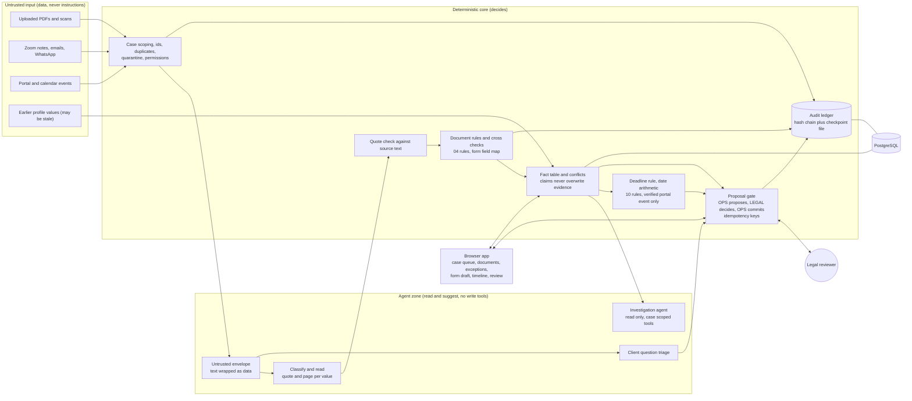

# Architecture and trust zones

TeamEcho prepares a case and a legal reviewer decides. Agents read and suggest. Deterministic code decides what is true enough to act on. Nothing is filed or sent, and every state change is written to a hash chained ledger.

## Who does what

| Step | Agent | Deterministic code |
|---|---|---|
| Intake normalisation | Reads a call, email or chat into claims with quotes | Stores them as claims, never as facts |
| Document interpretation | Classifies each page, reads fields with quote and page | Verifies every quote against the page text, applies the document rules, sets the outcome |
| Contradiction analysis | Suggests a value for a conflict | Compares values, opens the conflict, keeps every source, blocks the form field |
| Form draft | Suggests fields | Fills each field only from cited sources, unknown stays null with the reason |
| Client question triage | Labels the question | Picks a plain template, never predicts an outcome or gives legal advice |
| Deadline | none | Verified portal request date plus the rule offset, calendar entry only flagged |
| Approvals and audit | none | Gates, permissions, duplicate prevention, ledger |

## Trust rules that hold everywhere

- Text from a PDF, note or message is data. It goes through the envelope, the agents have no write tools, and an injection flag is raised and logged.
- A file is "uploaded" until the rules call it "usable". Exact duplicates, wrong client, unreadable, stale, expired and untranslated files do not satisfy a requirement.
- Only a verified portal event can set a deadline, and only the legal reviewer can import one as verified. A calendar entry is always a claim.
- Sending the packet or the form to legal is refused while exceptions or required documents are open.
- If the AI service fails, the file stays unread with a clear reason and is read again later. It is never settled as a finding about the file.
- Case scoped retrieval: a user sees only the cases assigned to them, and a record id from another case is refused.
- Deleting a file is a soft delete with a reason. The row stays for the audit trail and the facts are rebuilt without it.

## Where to look in the code

`backend/app/ingest` uploads and reading jobs, `ai` prompts and the reader, `validation` document and deadline rules, `facts` fact table and conflicts, `investigate` the read only agent, `replies` client drafts, `cases` queue, proposals, packet, form draft and stage, `core/audit.py` the ledger.
