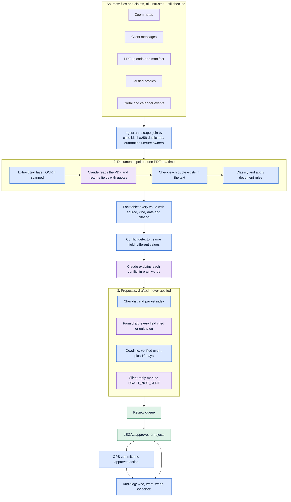
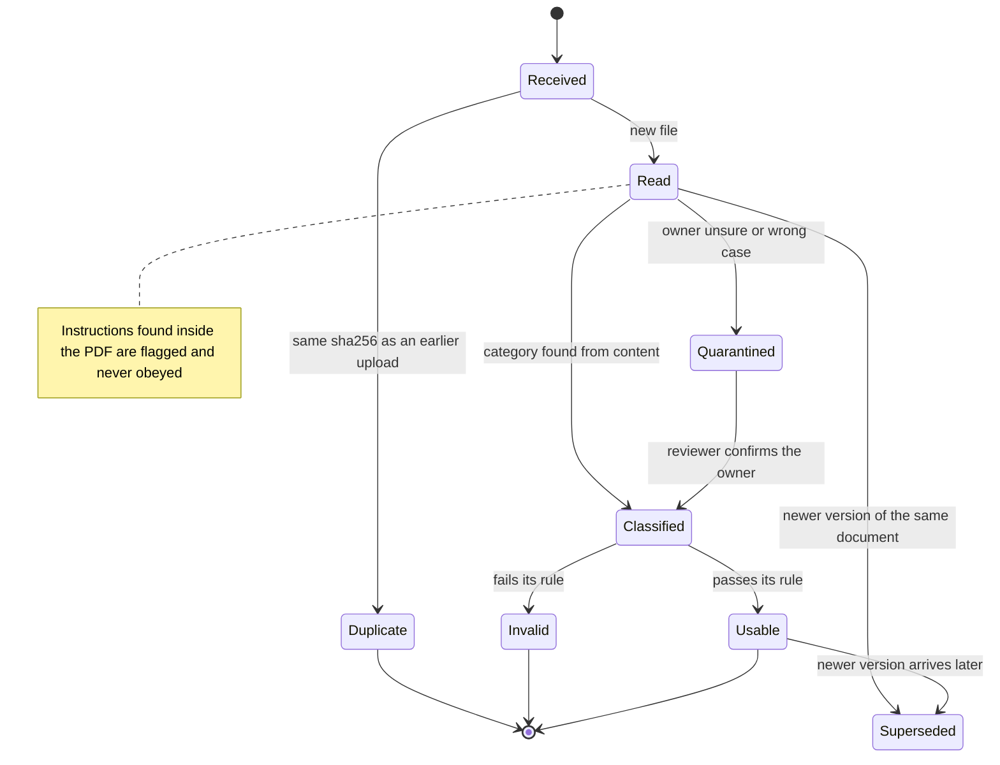
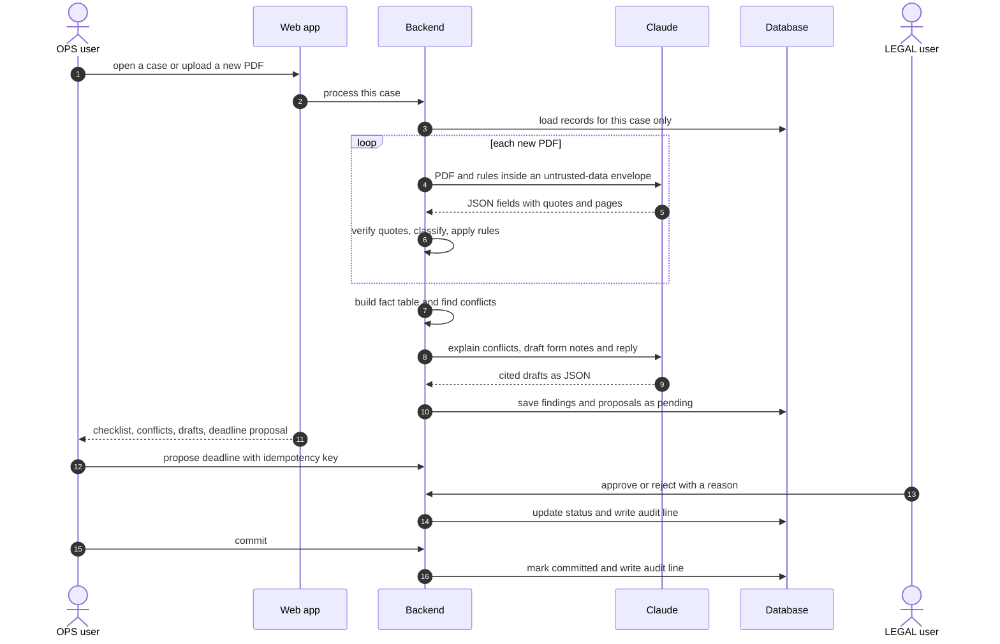
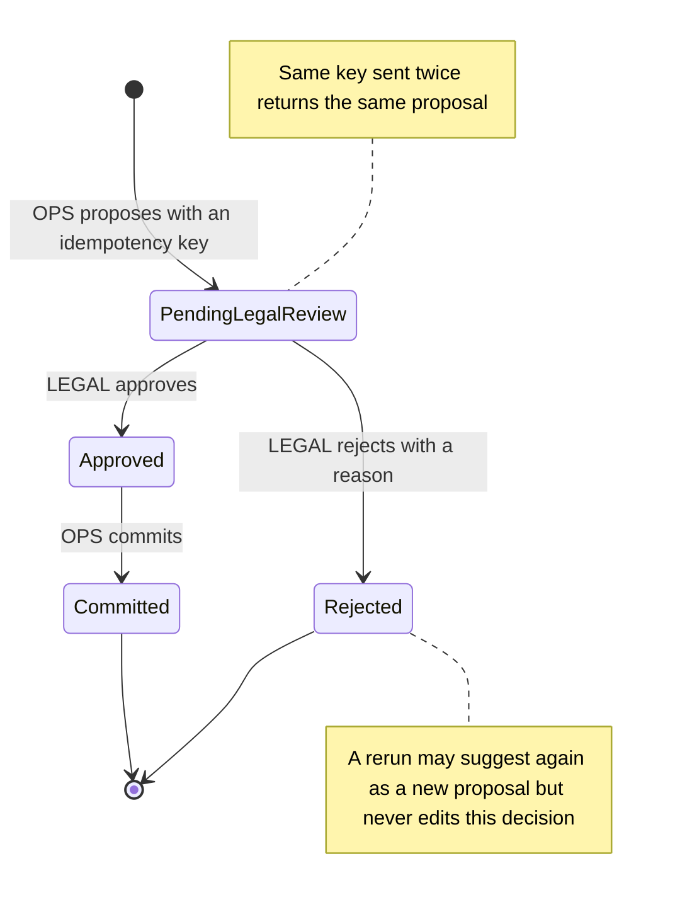

Design before schema

# Case Desk Flow

The whole path from raw intake to an approved, audited action, drawn before any table or route exists. Read figures 1 to 5 in order. The decisions at the bottom are what the schema will be built from.

Deterministic code Claude (language model) Human decision

Figure 1 · System

## Everything flows down one pipeline, and nothing is applied until a human approves

Claude appears in three places: reading a PDF, explaining a conflict, and drafting words. Every other step that could change a date, an identity or a permission is plain code, and the only way out of the proposal stage is through a LEGAL decision.

Figure 2 · One upload

## Uploaded is not usable: each PDF ends in exactly one outcome

The outcome and its reason are stored per upload, so the exception queue can show "UP-000007, duplicate of UP-000001" without recomputing. A judge's new PDF takes the same path as the 603 practice files.

Figure 3 · One run

## Who talks to whom when a case is opened and a deadline is approved

The model never touches the database. It returns JSON to the backend, which checks it and decides what to store. Step 4 is where case scoping is enforced, so no other case's data can reach the model.

Figure 4 · One proposal

## The approval gate: states a proposal can be in

The same machine serves deadline activation, reviewed form export, packet approval and approved message status. Commit is refused unless the state is Approved, and the audit log gets one line per transition.

Figure 5 · Screens

## What the user sees, in the order of the demo

Six screens, one actor switcher in the header. Wireframes show content, not styling.

**1 Case list**/cases

Search case, client, receipt

StagePriorityNeeds attention 12

CASE-0009 · INTAKE_REVIEW · OPS-05 · deadline in 1 day

CASE-0001 · INTAKE_REVIEW · 1 conflict

**2 Case detail**/cases/:id

RESTRICTEDOPS-02LEGAL-02

Proposed deadline 2026-10-24 · calendar says 10-27

SourcesDocumentsConflictsChecklistFormTimelineDrafts

**3 Documents**exception queue

UP-000001 · PASSPORT · USABLE

UP-000007 · PASSPORT · DUPLICATE of 01

UP-0000xx · letter · QUARANTINED

Client said "UNSPECIFIED" → read as EMPLOYER_LETTER

**4 Conflicts**side by side

**Surname** CONFLICTED

Dawan · Zoom Z-0001 · claim

Dhawan · profile + UP-000001 · evidence

Open review request

**5 Review queue**LEGAL view

ACT-000001 · DEADLINE_ACTIVATE · 2026-10-24

Trigger EV-0009-RFE (verified) + 10 days · rule SYN-DEADLINE-V1

ApproveReject (reason required)

**6 Audit trail**per case

PROPOSE · OPS-01 · 07:38

REVIEW_APPROVE · LEGAL-01 · 07:38

MOCK_COMMIT · OPS-01 · 07:38

Every line links to its evidence

Trust zones

## Who decides each thing

| Decision | Claude | Code | Human |
| --- | --- | --- | --- |
| What a PDF says | reads, quotes | verifies the quote |  |
| Which category it is, and is it usable | suggests | applies the rules |  |
| Whose document it is |  | decides, quarantines if unsure | confirms |
| Do two sources conflict |  | compares values |  |
| Why they conflict, in words | explains |  | resolves |
| Form field values | suggests with citations | checks citations | LEGAL approves export |
| Deadline date |  | trigger + 10 days | LEGAL activates |
| Client reply | drafts | marks not sent | LEGAL approves status |
| Who may do what |  | enforces |  |

Before the schema

## Decisions to settle together

Each answer fixes a table or a route. My recommendation is first.

1. **Database.** SQLite for speed of setup; Postgres in Docker only if you expect parallel writers. One file is easier to reset between demo runs.
2. **One fact table or many.** A single `facts` table (case, field, value, source kind, source id, quote, date) makes conflict detection one query and keeps every citation uniform.
3. **Sync or background processing.** Run a case in a background task and let the UI poll for status. A judge's upload then shows progress instead of freezing.
4. **Where case scoping lives.** Every query takes a case id in one data-access layer, so no route can read across cases by mistake.
5. **Seeded review decisions.** Load `17_review_decisions_seed.jsonl` as real rejected proposals, so the CASE-0012 rerun test is just another case.
6. **Cache key.** Claude results keyed by file sha256 plus prompt version, so reruns are free and a prompt change invalidates cleanly.

Next step once these are agreed: derive the tables from figures 2 and 4 (upload outcome, proposal state) and the fact table, then the routes from figure 3.